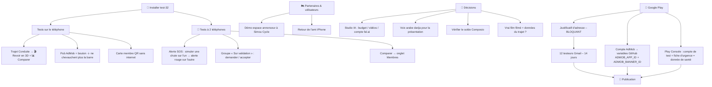

# MotoRoute – Point de reprise

**Point de reprise : 22 octobre 2026 — test-43 : présentation d'entrée qui ne marchait pas sur le 2ᵉ téléphone → les 9 vidéos étaient chargées d'un coup (trop pour les décodeurs d'un téléphone modeste) ; maintenant 2-3 à la fois, photo réaliste d'attente (video/sceneN.jpg), plus jamais de décor 3D ; vidéo illisible signalée à Sentry. Avant : test-42 : « Revoir mon trajet en 3D » et la simulation dessinée de l'Inclinaison colorée RETIRÉES (Elaid : pas de dessin animé dans l'app ; ne les remettre que sous forme de vraies vidéos réalistes, avec son accord). Avant : test-41 (inclinaison fiabilisée, SOS : vrais rapports SMS, boutons de test, sirène vérifiée côté serveur).**

## ✅ test-41 (22/10) — retours d'Elaid sur test-40
**Constats d'Elaid** : en voiture sur autoroute, inclinaison jusqu'à 71° sans pencher le téléphone ; SOS testé avec le 2ᵉ téléphone : l'appel part mais le contact n'entend pas la voix, le SMS n'arrive jamais, la sirène ne sonne pas.

**Diagnostic serveur (Claude, via les connecteurs Supabase)** :
- Clé Firebase OK, jeton Google OK, jetons des 2 téléphones (Elaid, Ali) **valides** (contrôle FCM « validate_only », aucune notification envoyée).
- La sirène n'a pas sonné car **personne n'était relié** : 0 ange gardien, et les comptes Elaid/Ali ne sont dans aucun groupe commun → la fonction `sos-push` a répondu « 0 destinataire » (journal du 20/10, 21 h 11).
- Fonction temporaire `fcm-check` désactivée (renvoie 410) → **à supprimer** dans Supabase → Edge Functions (le connecteur ne sait pas supprimer).

**Inclinaison** : 71° = plafond du calcul (asin 0,95). Causes : axe de calibrage resté celui du support moto alors que le téléphone était posé autrement dans la voiture, vibrations amplifiées par la vitesse. Corrections : axe vertical suivi en continu (plus besoin de recalibrer), gyroscope lissé et limité à 50°/s, contrôle par le virage mesuré au GPS (≤ angle GPS + 10° sauf virage franc et régulier au gyroscope), dérive du gyroscope apprise en ligne droite, plafond 62°, zone morte < 4°.
Simulation (avant → après) : voiture tout droit 120 km/h avec vibrations 44° → 4,5° max (0° affiché) ; courbe d'autoroute r = 800 m : 40° → 8° (angle physique 8°) ; moto virage 25,3° → 25,2° ; virage 34,3° → 34,3° ; entrée de virage : 25° atteint en ≈ 2 s comme avant.

**SOS** :
- Voix pendant l'appel GSM : impossible (Android). Textes corrigés : l'appel fait sonner le contact, la voix arrive chez lui par la **sirène ange gardien**.
- SMS : l'ancien « 📬 reçu » était faux (il ne lisait pas le rapport de l'opérateur, et Android 12+ retirait ce rapport à cause de FLAG_IMMUTABLE). Maintenant : vrai statut (remis / échec / en attente / pas de rapport → vérifier Spam ou Messages bloqués) et **nom de la SIM utilisée** (ex. « SIM 2 (Mobilis) »).
- Nouveau bouton **📩 Tester le SMS** (SMS simple sans GPS) et **🔔 Tester la sirène chez eux** (carte Anges gardiens).
- Écran SOS : message rouge clair quand personne n'a reçu la sirène.

**À tester par Elaid (2 téléphones)** :
1. Installer test-41 sur les deux.
2. Sur le 2ᵉ téléphone (compte Ali) : Route → Détection de chute → « Veiller sur un motard » → entrer le code d'Elaid.
3. Sur le téléphone d'Elaid : « 🔔 Tester la sirène chez eux » → le 2ᵉ téléphone doit sonner et lire le message.
4. « 📩 Tester le SMS » : noter la SIM affichée et le rapport de l'opérateur ; regarder aussi Spam / Bloqués sur le 2ᵉ téléphone.
5. Trajet en voiture puis à moto : inclinaison proche de 0° en ligne droite.

## 🚧 En cours (20/10, 17 h 55) — Alertes sonores gratuites + « anges gardiens »
Constats : SMS remis (accusé de réception) mais pas vu par le contact → filtré chez lui (Spam / Bloqués / Expéditeurs inconnus) ; voix pendant l'appel GSM impossible (Android interdit d'injecter du son, l'anti-écho efface le haut-parleur). Aucun service d'appel gratuit durable (essai Twilio : 30 jours, 5 numéros).
Solution choisie par Elaid : notification d'urgence gratuite (Firebase) → le téléphone du proche sonne (sirène) et lit l'alerte à voix haute.
- ✅ Projet Firebase « Motoroute » (motoroute-9f566), appli Android com.motoroute.app enregistrée.
- ✅ Clé de compte de service : Google Doc « Clé google base » (Drive, dossier Secret). ⚠️ Visible sur des captures du chat → la régénérer et supprimer l'ancienne une fois tout validé.
- ✅ Supabase : tables push_tokens, guardian_codes, guardians, sos_push_log + fonctions mr_my_guard_code, mr_guard_join, mr_guard_list (script supabase/alertes-sonores.sql exécuté par Elaid, vérifié).
- ✅ Fonction serveur `sos-push` en ligne (Supabase Edge Functions).
- ✅ Code app prêt sur la branche `alertes-sonores` : www/js/push.js (jeton, canal sirène, réception, lecture vocale, carte « Mes anges gardiens » avec code à 6 lettres), MrSms.speak (voix sur canal alarme), sirène android-res/sos_alarm.wav, plugin @capacitor/push-notifications, SOS qui appelle sos-push.
- ✅ Secret `FCM_SERVICE_ACCOUNT` enregistré dans Supabase par Elaid (20/10, 18 h 03).
- ✅ google-services.json reçu (texte collé par Elaid) → android-res/google-services.json ; branche fusionnée → test-40.
- ⏳ À FAIRE : (4) tester avec 2 comptes (code ange gardien, simulation de chute → sirène + voix) ; (5) le test « afficher la carte anges gardiens avec faux serveur » n'a pas été lancé.

## ✅ test-39 (20/10, 17 h 20)
- Essai test-38 d'Elaid : l'app affiche « SMS parti » mais le contact ne reçoit rien ; après le SMS, aucun appel ; avec « Tester l'appel vocal », l'appel passe mais le contact n'entend rien au décroché.
- SMS : un seul SMS court (≤ 160 caractères en FR/EN), **sans lien internet** (les liens Google Maps font souvent bloquer le SMS par l'opérateur ou le filtre anti-spam du téléphone qui reçoit) → coordonnées en clair « GPS 36.71234,4.04567 ».
- Simulation : le SMS TEST est maintenant **suivi de l'appel de test** (avant : appel seulement si le SMS échouait). Vraie chute : SMS puis appel (inchangé, selon la case).
- Voix pendant l'appel : non entendue par le contact → limite d'Android (une app ne peut pas injecter de son dans un appel GSM ; le filtre anti-écho efface le haut-parleur). Solution fiable = appel vocal lancé par un serveur (Bird) → décision d'Elaid à prendre.

## ✅ test-38 (20/10, 16 h 40)
- Demande d'Elaid : si le SMS ne passe pas, appeler le contact et lui annoncer la chute par un message vocal.
- Vraie chute : SMS puis appel (même si l'option d'appel est décochée quand aucun SMS n'est parti). Simulation : appel de test seulement si aucun SMS n'est parti.
- Pendant l'appel : haut-parleur activé + volume au maximum + message lu en boucle par la synthèse vocale du téléphone (FR / AR / EN) : nom, moto, « a fait une chute… », coordonnées GPS chiffre par chiffre. Le micro transmet la voix (Android n'autorise pas d'injecter du son directement dans un appel) → à valider sur le vrai téléphone : certains filtres anti-écho peuvent atténuer la voix.
- Bouton « 🔊 Tester l'appel vocal » dans la carte « Détection de chute » (avec confirmation).
- Plan B si la voix passe mal : appel vocal envoyé par un serveur (ex. Bird, payant, nécessite internet).

## ✅ test-37 (20/10, 16 h 20)
- Essai test-36 : l'app disait « SMS envoyé » mais le contact n'a rien reçu → l'ancien module ne vérifiait pas le vrai résultat.
- Module MrSms refait : choix de la carte SIM (SIM SMS par défaut, sinon 1re SIM active — utile sur double SIM), vrai résultat du réseau (pas de réseau / mode avion / refus opérateur-crédit / pas de réponse en 60 s), accusé de réception « 📬 reçu par le téléphone » quand l'opérateur le fournit. Autorisation READ_PHONE_STATE ajoutée (groupe Téléphone).
- SMS court sans émojis ni accents (≈ 185 caractères, 2 parties) : « MotoRoute SOS: … ».

## ✅ test-36 (20/10, 15 h 45)
- Essai d'Elaid en test-35 : « SMS non envoyé (autorisation SMS refusée) ». Cause : Android 15+ bloque l'autorisation SMS des apps installées par APK (hors Google Play) → il faut ⋮ → « Autoriser les paramètres restreints » dans les infos de l'app, puis Autorisations → SMS → Autoriser. Disparaît une fois l'app sur Google Play.
- Carte « Détection de chute » : état de l'autorisation (✅ / ❌), boutons « Autoriser les SMS » et « Ouvrir les réglages » (nouvelle méthode Android `openSettings`) + explication.
- Écran SOS : plus de « SMS envoyé » trompeur quand rien n'est parti ; en simulation, l'autorisation est redemandée avant l'envoi.

## ✅ test-35 (20/10, 15 h 15)
- Langue : un seul bouton 🌐 qui affiche la langue actuelle (FR / ع / EN) ; un appui ouvre un petit menu Français / العربية / English. Place gagnée dans la barre du haut.

## ✅ Fait le 20/10 (14 h 50) — test-34 : corrections après l'essai d'Elaid
- **SOS de chute vraiment automatique** (Android) : au bout des 2 min, le téléphone envoie **lui-même un SMS** (nom, moto, groupe sanguin, lien Google Maps) aux 1 ou 2 numéros de la fiche d'urgence, puis **appelle le premier**. Marche sans internet (le réseau mobile suffit). Le GPS est redemandé juste avant l'envoi s'il manquait. Module Android `MrSms` écrit par `scripts/patch-android.js` (autorisations SEND_SMS + CALL_PHONE).
- « Simuler une chute » : SMS et alerte aux groupes marqués **🧪 TEST — ce n'est PAS un vrai accident**, sans appel.
- Fiche d'urgence : **deuxième numéro** ; accès direct depuis 🪪 Mon espace (bouton « Fiche d'urgence et contact SOS ») et depuis la carte « Détection de chute » (contact en vert, ou en rouge s'il manque). Activer la détection demande les autorisations SMS/Téléphone puis ouvre la fiche si aucun numéro.
- iPhone / navigateur : un SMS ne peut pas partir seul (limite d'Apple) → le SMS s'ouvre prérempli, il faut appuyer sur Envoyer ; c'est écrit dans l'app.
- WhatsApp automatique : **impossible depuis le téléphone** (WhatsApp l'interdit) ; possible seulement via un serveur WhatsApp Business payant (ex. Bird) → à décider plus tard.
- **Boutons du haut** : le titre « MotoRoute » passait par-dessus et bloquait les appuis → corrigé ; boutons agrandis (44 px de haut).
- **Coupures d'image** : les vidéos de fond (8 s) sautaient d'un coup de la fin au début → maintenant fondu enchaîné avec le second lecteur, 1 s avant la fin.
- Politique de confidentialité FR/AR/EN : SMS et appel automatiques ajoutés.
- ⚠️ **Google Play** : l'autorisation SEND_SMS impose de remplir la **déclaration « Autorisations SMS et journal d'appels »** dans la Play Console → cas « Alertes de sécurité physique / d'urgence par SMS » (https://support.google.com/googleplay/android-developer/answer/10208820). Si Google refuse : plan B = SMS envoyés par un serveur.

## ✅ Fait le 20/10 (14 h) — suivi des plantages Sentry
- Projet Sentry **motoroute** (organisation remili-elaid, région Europe) créé par Claude via le connecteur Sentry.
- `www/lib/sentry.min.js` (Sentry 11.8.0, embarqué : marche aussi hors ligne) + `www/js/sentry-init.js` chargés en tête de `index.html`.
- Confidentialité : pas d'utilisateur, pas d'IP, liens coupés avant « ? » / « # », positions GPS, e-mails et téléphones masqués, ni la console ni ce qui est tapé.
- Version dans Sentry : `motoroute@test-NN` sur Android (écrit par `scripts/patch-android.js`), `motoroute@web` sur iPhone/navigateur.
- Pour voir les erreurs : demander à Claude « regarde Sentry » (connecteur) ou sentry.io → Issues.

## ✅ Fait le 20/10
- Analyse complète de l'app + corrections : SOS chute **réellement envoyé aux groupes** (alerte rouge + sirène chez les membres, app ouverte), bouton « 📣 Alerter mes groupes », sécurité des groupes, confidentialité FR/AR/EN à jour, QR et polices hors ligne, AdMob configurable, fenêtres MotoRoute à la place des alertes grises.
- **🎬 Revoir mon trajet en 3D** (onglet Conduite) : route 3D du vrai tracé, vitesse + inclinaison, caméras 360°/poursuite/drone/côté/cinéma, carte OSM, tronçon A→B, film à partager.
- Film réaliste IA (Haïzer → Tikjda) : fait puis **retiré de l'app** (« trop d'erreurs ») ; ne pas le remettre sans accord. ≈ 6 $ de clips sur le compte Composio.
- **Supabase : les 3 scripts exécutés** (sécurité groupes, alertes SOS, comparaison trajets).

## 🔜 Reste à faire

1. **Installer test-32** (onglet Releases du dépôt).
2. **Tests seul** : trajet → Revoir en 3D + Comparer ; pub et bouton ＋ ; carte membre QR sans internet.
3. **Tests avec un 2ᵉ téléphone** (quand Elaid en a un) : alerte SOS de chute entre 2 comptes du même groupe (app ouverte sur le 2ᵉ, simuler la chute sur le 1er, attendre 2 min) ; groupe « Sur validation » ; Comparer → Membres.
4. **Simou Cycle** : montrer la démo de l'espace annonceur.
5. **Ami iPhone** : retour sur installation, connexion, GPS, musique.
6. **Google Play** : justificatif d'adresse (bloquant) → 12 testeurs Gmail ; compte AdMob ; compte de test + déclaration santé dans la Play Console.
7. **Décisions** : Studio IA, voix arabe, solde Composio, vrai film filmé.

⚠️ Règle : chaque changement de `www/` est aussi copié dans la version iPhone (`scripts/maj-version-web.sh`) dans le même envoi.
Pour reprendre, dis simplement à Claude : « On reprend MotoRoute, lis REPRISE.md dans mon dépôt Elaid ».

## Version du 20/10 (midi) — film d'exemple dans l'app (RETIRÉ à 12 h 55 : Elaid trouve « trop d'erreurs » ; ne plus le remettre sans son accord)

- **Film réaliste v3** (Haïzer → col de Tikjda, Elaid sur Z H2, 1 min 14) : 12 plans Veo, sans marche arrière (les passages où la caméra tournait plus vite que la moto ont été coupés après mesure du mouvement), plan « au ras de la caméra » demandé par Elaid (caméra fixe au bord du virage, la moto passe en frôlant l'objectif), 360° gardés seulement là où la moto avance clairement, compteur / inclinaison calés sur l'image, kilomètres dans l'ordre (2,2 → 23,8 km). Coût total des clips IA ce jour ≈ 6 $ (compte Composio d'Elaid).
- **Dans l'app** : `www/video/exemple-trajet.mp4` (540×960, 10 Mo) + affiche `exemple-trajet.jpg`. Carte « 🎥 Film de trajet – exemple » en tête de l'onglet Conduite (mention « images créées par IA, données GPS réelles ») et bandeau d'accroche en haut de Sorties (✕ pour le masquer) qui ouvre le film.
- Rappel honnête : un film pour chaque membre sur sa route = images IA « ressemblantes » (pas sa vraie route), ≈ 3–4 $ par film → à décider plus tard (option payante / limitée).

## Version du 20/10 (matin) — analyse complète de l'app, corrections + Revoir mon trajet en 3D

**Supabase : FAIT le 20/10 à 13 h 16 par Elaid** (sos-alertes + securite collés ensemble → règle members_insert_safe visible ; comparaison-trajets → « Success »). Astuce : coller le CONTENU des scripts, pas leur nom ; sur téléphone l'éditeur ajoute parfois une « ) » en trop à la fin, à effacer.

~~Ancienne consigne :~~ **À faire par Elaid dans Supabase (SQL Editor → coller → Run), dans cet ordre :**
1. `supabase/securite.sql` — ferme la porte des groupes : plus personne ne peut entrer dans un groupe « sur validation » ou privé sans l'accord du chef / le code, et un membre ne peut plus se mettre « actif » ou « chef » lui-même. Le résultat affiche la liste des règles restantes.
2. `supabase/sos-alertes.sql` — table `sos_alerts` pour les alertes SOS envoyées aux groupes (+ temps réel, effacement après 7 jours).
3. (toujours en attente) `supabase/comparaison-trajets.sql`.
Testés tous les deux sur une base Postgres d'essai : entrée directe refusée (groupe sur validation, privé, se faire chef), demande « en attente » acceptée, chef qui crée son groupe OK ; SOS envoyé seulement vers ses groupes actifs, lu seulement par les membres, impossible d'usurper un autre compte.

**Corrections :**
- **SOS chute (le plus important)** : avant, l'écran disait « alerte diffusée au groupe » mais rien ne partait. Maintenant, après les 2 minutes, l'alerte (prénom, moto, groupe sanguin, position) est vraiment envoyée aux membres actifs de tous ses groupes ; l'écran dit si c'est envoyé (« ✅ Alerte envoyée à N groupes ») ou pourquoi pas (pas connecté, aucun groupe, pas de réseau → 3 essais). Chez les autres membres, l'app ouverte affiche une alerte rouge plein écran avec sirène, vibration et « 📍 Voir sa position ». SOS manuel (onglet Route) : nouveau bouton « 📣 Alerter mes groupes ». Limite honnête affichée : les membres la reçoivent si MotoRoute est ouvert (les notifications app fermée demanderont Firebase plus tard).
- **Politique de confidentialité** (FR/AR/EN, 20/10) : trajets partagés, alertes SOS, playlists, Brevo, Radio Browser/Audius, caméra/micro, OpenStreetMap pour la 3D, fiche d'urgence = donnée de santé.
- **AdMob** : il suffira d'ajouter dans GitHub → Settings → Secrets and variables → Actions → **Variables** : `ADMOB_APP_ID` (ca-app-pub-…~…) et `ADMOB_BANNER_ID` (ca-app-pub-…/…). Sans elles, ce sont toujours les pubs de test.
- **Sans internet** : le QR de la carte membre et les polices sont maintenant dans l'app (`www/lib/qrcode.min.js`, `www/lib/fonts/`).
- **Fenêtres d'information** au style MotoRoute à la place des alertes grises du téléphone.
- Protection du texte renforcée (apostrophe).
- **Trajets** : chaque point du tracé enregistre maintenant aussi la vitesse, le temps, le côté du virage et l'altitude (sert à la 3D).

**Nouveau : 🎬 Revoir mon trajet en 3D** (onglet Conduite, carte « Revoir mon trajet en 3D » + bouton 🎬 3D sous chaque trajet avec tracé) — `www/js/replay3d.js` :
- route reconstruite en 3D à partir du tracé GPS (relief si le téléphone a donné l'altitude), paysage ou **🗺 Carte OpenStreetMap** drapée au sol, bordures colorées selon l'inclinaison, drapeaux A/B, mini-carte.
- le pilote roule à sa vraie vitesse et avec sa vraie inclinaison ; livrée selon la moto du profil (Kawasaki / Z H2 : gris métal, cadre et liserés verts).
- caméras : 🔄 360° (on tourne autour du pilote), poursuite, drone, côté, 🎞 cinéma (enchaîne les plans).
- ✂️ choix du tronçon A → B, vitesse Auto (film ≈ 45 s), ×1, ×5, ×10, ×30 ; ⏺ Vidéo → film MP4 avec compteur, inclinaison, temps, distance → 📤 Partager / enregistrer (WhatsApp, Galerie… via les modules Capacitor `@capacitor/filesystem` + `@capacitor/share` ajoutés).
- « 👀 Voir une démo » : col de montagne fictif.
- Les anciens trajets (avant test-28) n'ont pas de tracé ; ceux enregistrés avant cette version ont un tracé sans vitesse/altitude : la 3D estime alors la vitesse et l'inclinaison.
- Vérifié dans un vrai Chrome (branche `verif-3d`, captures) : toutes les caméras, tronçon A→B, enregistrement MP4, ancien format de trajet.
- 1er film (3D de l'app) jugé « dessin animé » par Elaid → refait en **vidéo réaliste** comme la présentation : 8 clips Veo 3.1 Lite (8 s, 9:16, ≈ 0,40 $ chacun, ≈ 3,20 $ en tout) sur le vrai trajet Haïzer → col de Tikjda (OSRM + altitude, 23,8 km, 592 → 1510 m, virages jusqu'à 38°), pilote type Elaid (Z H2 gris/vert, blouson kaki-noir liseré vert, jean), compteur / inclinaison / km / altitude / mini-carte du vrai trajet incrustés, intro carte + fin. Fichier : branche `verif-3d`, `verif/film/MotoRoute-Elaid-ZH2-Tikjda-realiste.mp4`.
- Idée à décider : proposer ce « film réaliste de mon trajet » dans l'app (option payante / Studio IA : ≈ 3 $ de clips IA par film, demande un serveur et un compte de génération vidéo).

## Où tout se trouve

| Quoi | Où |
| --- | --- |
| Code de l'application | dépôt GitHub `elaidremili-sudo/Elaid`, fichier `www/index.html` |
| Version Android à installer | onglet **Releases** du dépôt (dernière : **test-21**) |
| Fichier pour Google Play (.aab) | même release, `MotoRoute-21.aab` |
| Présentation animée | `www/presentation.html` (+ `www/lib/three.min.js`) |
| Scripts SQL Supabase | dossier `supabase/` (déjà exécutés : `suppression.sql`, `validation-groupes.sql`, `playlists.sql` le 19/10) |
| Pages web publiques | `elaidremili-sudo.github.io/Elaid/` → `confidentialite.html`, `suppression-compte.html`, `nouveau-mot-de-passe.html` |
| Images Play Store | dossier `play-store/` (icône 512, bannière 1024×500, 5 captures) |
| Textes Play Store | doc Claude « MotoRoute – Fiche Google Play » |
| Clé de signature | Google Drive, dossier « Secret » (`motoroute-upload.keystore` + `motoroute-cle-secrets.txt`) — ne jamais partager |
| Serveur | Supabase, projet « Motoroute » (`ixtqlxltwuktpdznbhnx`) |
| E-mails (mot de passe oublié, confirmation) | Brevo (offre gratuite, 300 e-mails/jour), branché dans Supabase → Authentication → Emails → SMTP Settings |

## Comment une nouvelle version est fabriquée

Chaque envoi de code sur GitHub fabrique automatiquement une APK **signée** (secrets `MR_KEYSTORE` + `MR_KEY_PASS`) et un `.aab`, publiés dans Releases sous `test-N`. Les versions s'installent **par-dessus** l'ancienne, sans désinstaller.

## E-mails via Brevo (fait le 18/10, 22 h)

- Réglages SMTP dans Supabase : hôte `smtp-relay.brevo.com`, port `587`, identifiant `bec204001@smtp-brevo.com`, mot de passe = clé SMTP Brevo « Supabase MotoRoute » (rangée dans le dossier « Secret », sans date d'expiration).
- **Testé** : « Mot de passe oublié » → e-mail reçu → page « Nouveau mot de passe » → reconnexion OK.
- ⚠️ La clé Brevo **expire après 90 jours sans aucun envoi**. Si les e-mails n'arrivent plus un jour : Brevo → SMTP & API → générer une nouvelle clé → la recoller dans Supabase (champ Password).
- Ne **pas** activer le blocage des IP dans Brevo (Supabase envoie depuis des adresses qui changent).

## Version web pour iPhone (19/10, 19 h 45)

- Adresse : **https://elaidremili-sudo.github.io/Elaid/app/** — même app que l'APK (dossier `docs/app` = copie de `www`). Sur iPhone : ouvrir dans **Safari** → bouton Partager → « Sur l'écran d'accueil ».
- Après chaque changement de `www/`, relancer `scripts/maj-version-web.sh` pour mettre la version web à jour.
- 20 h 05 : lien vérifié en ligne (même fichier que `www/index.html`) et transmis à Elaid pour son ami à iPhone ; à faire : retour de l'ami (installation, connexion, GPS, musique).
- Limites sur iPhone : pas de pub AdMob, l'écran peut se mettre en veille, GPS/capteurs seulement app ouverte, bouton « Quitter » sans effet. Vraie app iPhone = compte Apple Developer (99 $/an) + TestFlight, plus tard.

## Point de reprise 19/10, 21 h 50 — reste à faire

1. **Installer test-29** : le premier téléchargement sur le téléphone a donné « package non valide ». Le fichier publié a été vérifié (intact, signé v2/v3, même clé que test-28, version 1.0.29) → supprimer le fichier téléchargé, le retélécharger, attendre la fin, l'ouvrir depuis l'app Fichiers.
2. **Exécuter `supabase/comparaison-trajets.sql`** dans Supabase (SQL Editor → Run) pour l'onglet « Membres » de la comparaison.
3. Tester sur la moto : un trajet dans Conduite (Démarrer → Arrêter) puis Route → Inclinaison colorée (tracé en couleurs) et Conduite → 📊 Comparer.
4. Vérifier la bannière AdMob et le bouton ＋ (Annonces, Groupes, Carnet) : ils ne doivent plus chevaucher la barre du bas.
5. Toujours en attente : retour de l'ami à iPhone, tester « Sur validation » avec 2 comptes, montrer la démo à Simou, justificatif d'adresse Google Play, 12 testeurs, compte AdMob.

Règle : chaque changement de `www/` part aussi sur la version iPhone (`scripts/maj-version-web.sh`) dans le même envoi.

## Version test-29 (19/10, 21 h 35) — l'écran ne clignote plus dans la comparaison

- Vidéo d'Elaid : le tableau de comparaison disparaissait/réapparaissait chaque seconde. Cause : la carte « Ma position (GPS) » de Conduite continuait de suivre le GPS alors qu'elle n'était plus affichée (vue Comparaison) ; à chaque position elle redessinait tout l'écran (et le tableau revenait au début).
- Correctif : le suivi GPS de cette carte est coupé tant que la comparaison est ouverte, il repart au « Retour ». Mesuré dans le navigateur avec un faux GPS : 6 redessins en 6 s avant, 0 après.

## Version test-28 (19/10, 21 h 15) — Inclinaison colorée qui marche vraiment

- **Conduite enregistre maintenant le tracé GPS** du trajet : un point tous les ~25 m (ou 5 s), avec l'inclinaison max entre deux points (au-dessus de 15 km/h). Max 3000 points par trajet ; le tracé est gardé pour les 5 derniers trajets seulement (place sur le téléphone). Aussi sauvé dans l'enregistrement de secours si l'app se ferme.
- **Route → MotoRoute Plus → « 🏍 Inclinaison colorée »** : dessine le dernier trajet en couleurs (vert < 20°, jaune 20–35°, rouge > 35°), départ en vert, arrivée en noir. L'ancien texte « arrivera avec la version Android » est retiré.
- **« ▶ Voir une simulation »** : un col de montagne fictif se dessine en 9 s avec « En ce moment : 29° à gauche · 55 km/h », boutons Rejouer / Fermer.
- Défis & badges : la phrase « classement entre motards demandera un serveur » est remplacée par « Conduite → 📊 Comparer ».
- Testé dans un navigateur avec faux GPS + faux gyroscope : 40 s de trajet → 400 points enregistrés et dessinés.
- Pas de fond de carte sous le tracé (dessin seul) ; une vraie carte en fond pourra venir plus tard.

## Version test-27 (19/10, 21 h) — comparaison plus facile à trouver

- Elaid ne trouvait pas la comparaison : le bouton n'apparaissait que sur les trajets enregistrés à partir de test-26 (ses anciens n'ont pas de départ/arrivée).
- Onglet **Conduite**, sous la carte vitesse/inclinaison : nouvelle carte **« 📊 Comparaison du trajet »** qui explique où toucher, dit si aucun trajet n'est encore comparable, et propose **« 👀 Voir un exemple »** (données fictives marquées « Exemple », onglets Mon évolution et Membres).
- Le bouton « 📊 Comparer » est maintenant visible sous **tous** les trajets ; sur un ancien trajet il explique pourquoi la comparaison est impossible.

## Version test-26 (19/10, 20 h 40) — comparaison d'un même trajet + pub

- **Comparaison du trajet** (onglet Conduite → bouton « 📊 Comparer » sur un trajet de l'historique ou dans le résumé). Pas une course : un tableau, une colonne par passage ou par pilote.
  - « Mon évolution » : mes passages sur le même trajet (6 derniers), le plus récent visible en premier, + « Depuis ton premier passage : ⏱ x:xx plus rapide · 📐 +x° ».
  - « Membres » : les membres actifs de mes groupes qui ont fait le même trajet (leur dernier passage). Il faut cocher « Partager mes trajets avec mes groupes » (désactivé par défaut). Les autres ne voient que le prénom et les chiffres, jamais la position.
  - Badges seulement sur ⏱ meilleur temps et 📐 plus penché ; vitesses moyenne/max/en virage affichées simplement, sans badge (choix d'Elaid).
  - « Même trajet » = même départ et même arrivée à 500 m près + distance ± 20 % (min. 1 km), ou la même sortie du club (sortie du jour à laquelle on participe).
  - Les trajets enregistrés avant test-26 n'ont pas de départ/arrivée : pas de bouton Comparer pour eux.
- **Serveur : exécuter `supabase/comparaison-trajets.sql`** (table `trajets` + fonction `trajets_comparables`). Sans ça, l'onglet Membres affiche « pas encore activée sur le serveur » ; « Mon évolution » marche sans serveur. Testé sur une base d'essai : seul le dernier passage des membres actifs ressort (ni membres en attente, ni inconnus) et personne ne lit directement les lignes des autres.
- **Pub AdMob** : la bannière se calait sur la hauteur de la barre du bas sans compter qu'elle flotte (style Futuriste) → elle chevauchait la barre ; le bouton ＋ était à hauteur fixe. Maintenant la bannière se place au-dessus du bord haut de la barre et le ＋ au-dessus de la bannière (selon sa vraie hauteur). À vérifier sur le téléphone (Annonces, Groupes, Carnet).

## Version test-24 (19/10, 19 h 30)

- **Barre du haut complète** (langue, 🔑 compte, ?, 🎨, 🪪, 🎬) : elle était décalée de 14 px vers la gauche en style Futuriste, et trop large sur téléphone → « FR » coupé. Corrigé (marges égales, boutons un peu plus compacts sous 440 px de large), vérifié à 360 et 393 px.
- **Paysage plein écran** : l'app s'affiche aussi du côté de la caméra (plus de bande noire à gauche) — réglage Android `windowLayoutInDisplayCutoutMode = shortEdges` ajouté par `scripts/patch-android.js` ; marges de sécurité CSS (`safe-area-inset-left/right`) pour la barre du bas et le bouton ＋.
- **Pub AdMob masquée en paysage** (elle recouvrait la moitié de l'écran et la barre du bas) ; elle revient en portrait.

## Versions test-22 et test-23 (19/10, soir) — style Futuriste + vidéos dans les rubriques

- **Style « Futuriste » par défaut** (Apparence → Style : Futuriste / Classique) : cartes en verre avec contour lumineux aux couleurs du thème, boutons en dégradé avec reflet qui passe et effet d'onde au toucher, bouton ＋ lumineux qui pulse, barre du bas flottante en verre avec l'onglet actif qui brille, fenêtres et champs assortis, apparition animée des cartes au changement d'onglet. Respecte les couleurs, formes (rond/doux/carré), clair/sombre, FR/AR/EN et « mouvements réduits » du téléphone. « Classique » remet l'ancien look.
- **Bandeau vidéo en haut de chaque rubrique** (Sorties, Annonces, Groupes, Route, Conduite, Carnet) : clip réaliste en boucle, titre de la rubrique style HUD + phrase d'accroche (FR/AR/EN), coins lumineux. Fichiers `www/video/tab_1.mp4`… `tab_6.mp4` (640×360) + images d'attente `tab_N.jpg`. Numéros = onglets : 1 Sorties, 2 Annonces, 3 Groupes, 4 Route, 6 Conduite, 5 Carnet.
- **Fond vidéo plein écran au choix** (Apparence → Fond → Vidéo) : clip vertical derrière toute la rubrique (`tabv_N.mp4`, 540×960). Une seule vidéo joue à la fois, rien ne joue quand l'app est en arrière-plan.
- Poids ajouté : environ 10,5 Mo.
- **Fond d'écran assorti** (Fond → Photo, par défaut) : l'ancienne photo de moto rouge est remplacée, en style Futuriste, par l'image réaliste de chaque rubrique (`tabv_N.jpg`), avec un lent mouvement de caméra et un fondu au changement d'onglet. « Ma photo » et « Uni » inchangés.

## Version test-21 (19/10)

- **Présentation en vidéos réalistes** : chaque scène (9) a son clip vidéo réaliste en fond, généré par IA (Veo 3.1 Lite, 8 s, vertical) — col de Tikjda à l'aube avec une hyper naked type Z H2 (ouverture), groupe qui monte vers le Djurdjura, club à la station, photo de groupe au sommet, moto orange dans un virage, entraide au coucher du soleil, file de motos sur la crête au crépuscule, boutique moto de village la nuit, survol du Djurdjura au lever du soleil. Fichiers `www/video/scene1.mp4` à `scene9.mp4` (540×960, sans son, 8,4 Mo en tout). Textes, maquettes et voix inchangés ; le décor 3D reste en secours si une vidéo ne se charge pas (et ne tourne plus pendant les vidéos, économie de batterie).
- Les clips sont arrivés dans le dépôt par l'action GitHub « Récupérer les vidéos de la présentation » (`.github/workflows/videos.yml`, liste `www/video/sources.txt`). Pour remplacer un clip : changer son lien dans `sources.txt`.
- Correctif : « NaN » dans Vmax / Angle max de la scène Conduite.
- Vidéo bonus (hors app) : Z H2 en 360° glace → feu dans un garage, « variante A » validée par Elaid.

## Version test-19 (19/10)

- Éditeur 🎬 : le bouton « Caméra » ne proposait que la vidéo (Android choisit la vidéo quand on demande photo + vidéo à la fois). Remplacé par deux boutons : **📷 Photo** et **🎥 Vidéo**.

## Version test-18 (19/10)

- **Compte obligatoire** : sans connexion, l'app reste bloquée sur l'écran « Bienvenue sur MotoRoute » (connexion / création de compte / mot de passe oublié / confidentialité), fond opaque, impossible de le fermer (retour, Échap, autre fenêtre : il revient). Le bouton devient « Quitter » et ferme l'application (module `@capacitor/app`). La présentation passe avant, puis l'écran s'ouvre sur « Créer un compte ». Une déconnexion ou une suppression de compte ramène sur cet écran ; la musique s'arrête.
- Le module Supabase est maintenant dans l'app (`www/lib/supabase.js`, v2.45.4) au lieu d'être chargé depuis internet : un membre déjà connecté garde l'accès même sans réseau au démarrage.
- ⚠️ Google Play : comme l'app exige un compte, il faudra donner un compte de test à Google dans la Play Console (Contenu de l'application → Accès à l'application).

## Version test-17 (19/10)

- **Retouche IA dans l'éditeur 🎬** (tout se fait sur le téléphone, rien n'est envoyé) : « ✨ Améliorer » (lumière, contraste, couleurs automatiques), curseur Couleurs, « 🙂 Flouter les visages » (MediaPipe Face Detection, Apache 2.0, fichiers dans `www/lib/mp-face/`, analyse en plusieurs passes pour les visages lointains des photos de groupe), « ✋ Flouter une zone » (toucher la photo pour pixeliser une plaque ou un visage, toucher un flou pour le retirer), « ↺ Retirer les flous ». Pour une vidéo, les flous restent fixes.
- **Film souvenir** (page d'un groupe, au-dessus des photos) : jusqu'à 15 photos du groupe assemblées en vidéo verticale 720×1280 (titre, effet de zoom, légendes, fin MotoRoute) avec musique générée par l'app (libre de droits) → Télécharger (MP4 si le téléphone le permet) ou Ajouter aux souvenirs.
- Export vidéo de l'éditeur en MP4 quand c'est possible (plus simple pour WhatsApp).
- Pas de détourage (enlever le fond) : aucun modèle gratuit hors ligne ne garde la moto ; possible plus tard avec un service payant.
- `playlists.sql` exécuté par Elaid le 19/10 (« Success »).

## Version test-16 (19/10)

- **Bibliothèque musicale — playlists** (carte Musique, onglet « Playlists ») : bouton ＋ sur chaque radio, morceau ou lien → ajouter à une playlist perso (sur le téléphone, ex. « Route du dimanche ») ou à la **playlist partagée d'un groupe** (serveur, table `group_tracks` : seuls les membres actifs voient/ajoutent, chacun retire ses ajouts, le chef peut tout retirer). « ▶ Tout lire » enchaîne la playlist. Uniquement des liens (Audius, radios, MP3) : aucun fichier audio n'est stocké sur le serveur.
- Onglets de la carte Musique sur une seule ligne qui défile.

## Version test-15 (19/10)

- **Rallye / course retirés** à la demande d'Elaid (pas de mode compétition ni course dans l'app ; `rallye.sql` supprimé, ne pas l'exécuter).
- Conservé de test-14 : correctif des recherches Musique (radios, morceaux, liens) qui ne se perdent plus quand l'écran se redessine.

## Version test-13 (19/10)

- Carte Musique : nouvel onglet **« Morceaux »** = musique à la demande via le catalogue libre **Audius** (raccourcis Tendances, Raï, Chaabi, Rap, Électro, Rock + recherche titre/artiste ; enchaînement automatique ; ★ pour garder un morceau dans « Mon annuaire »). Appels avec `app_name=MotoRoute` ; si Audius exige une clé, la coller dans `AU_KEY` (clé gratuite sur https://api.audius.co/plans, la clé « API Key », jamais le « Bearer Token »).

## Version test-12 (19/10)

- Carte « Musique » repliée par défaut (une seule ligne avec les commandes, ▾ pour ouvrir), liste plus courte ; mini-lecteur plus fin, placé au-dessus de la bannière publicitaire quand elle est affichée.
- Annonces : les boutons (Contacter, ♡, Noter, Signaler, Supprimer) passent à la ligne au lieu de déborder.

## Version test-11 (19/10)

- **Présentation animée au premier lancement** (`www/presentation.html`) : 9 scènes en 3D (Djurdjura, col de Tikjda, motos), choix Français / العربية, musique générée sans droits, voix off française (Kokoro « siwis », Apache 2.0 / données SIWIS CC BY 4.0) en une seule piste continue, sous-titres. Arabe : sous-titres + musique, **pas de voix** (en attente d'un MP3 en darija, voix de jeune femme algéroise). Bouton « Plus tard », bouton final « Créer mon compte » qui ouvre 🔑. Revoir : aide « ? » → « ▶ Revoir la présentation ».
- **Lecteur musique intégré** (onglet Route, carte « Musique ») : radios en ligne gratuites sans compte (annuaire Radio Browser, raccourcis Algérie, Raï, Chaabi, Kabyle, Rock, Monde + recherche), ★ pour enregistrer dans « Mon annuaire », « Lien » pour lire ou enregistrer une adresse MP3/flux (https), mini-lecteur au-dessus de la barre du bas qui reste quand on change d'onglet, commandes du casque Bluetooth. Seuls les flux https sont proposés.
- Contient aussi le numéro de Simou Cycle (prévu pour test-11).
- À faire plus tard : clé gratuite Audius (morceaux à la demande), playlist du club sur Supabase, lecture écran éteint (module Capacitor de lecture en arrière-plan), voix arabe en darija.

## Version test-10 (18/10, soir)

- **Icônes de la barre du bas** redessinées, plus sobres : route, étiquette, blason (Groupes), boussole, compteur, carnet.
- **Vitrines partenaires** dans Annonces : bouton « Voir la vitrine » (promotions avec prix barré et date de fin, nouveautés, produits, bouton « Je suis intéressé » → WhatsApp avec message prêt), produits « à la une » affichés sur la carte du partenaire.
- **Espace annonceur (démo)** : lien « ⚙ Espace annonceur » sous chaque partenaire → statistiques (vues, clics WhatsApp, appels, itinéraires), « Ma vitrine » (présentation, téléphone, adresse, horaires), « Publier » (promo / produit / nouveauté avec photo), « Aperçu client ».
- Numéro de Simou Cycle (+213 550 31 83 68) inscrit dans l’app, sera inclus dans la prochaine version (test-11).
- Simou Cycle a 6 publications marquées « Exemple » pour la démonstration (bouton « Remettre la démo à zéro »).
- ⚠️ Démo : tout est enregistré sur le téléphone. Pour la vraie version : un compte partenaire sur Supabase (table des vitrines + photos) pour que Simou gère sa vitrine depuis son propre téléphone.

## Fait le 18 octobre 2026

- Supprimer une sortie, un groupe, son compte (serveur + app) ; sorties passées rangées dans un historique
- Clé de signature fixe ; numéro de version automatique
- Icône MotoRoute (route + montagne, or sur fond sombre)
- Écran toujours allumé pendant Conduite et Suivi en direct ; résumé de trajet récupéré si l'app se ferme
- QR de la carte membre correct en mode sombre
- Pages Confidentialité et Suppression de compte (FR / AR / EN), en ligne sur GitHub Pages
- Groupes « sur validation » : le chef accepte ou refuse les demandes
- Publicités AdMob **en mode test** (Annonces, Groupes, Carnet — jamais pendant la conduite) : vérifié sur le téléphone
- « Mot de passe oublié ? » + page pour choisir un nouveau mot de passe — **fonctionne avec Brevo**
- Supabase : Site URL = `https://elaidremili-sudo.github.io/Elaid/`, Redirect URL = `https://elaidremili-sudo.github.io/Elaid/**`
- Nom du partenaire corrigé : **Simou Cycle**
- Fiche Google Play préparée (textes FR/AR/EN, images, formulaire « Sécurité des données »)

## Comptes de test (Supabase)

`elaidremilipro@gmail.com` (compte principal dans l'app), `elaidremili@gmail.com` (chef du groupe « Fd »), `elaidremili@yahoo.fr` (débloqué le 18/10). Les deux comptes Zina appartiennent à quelqu'un d'autre.

## À faire ensuite (mis à jour le 19/10 à 15 h)

**Elaid, à tester sur le téléphone (test-19) :**
1. Éditeur 🎬 : **📷 Photo** ouvre bien l'appareil photo, **🎥 Vidéo** la caméra.
2. Sans compte : l'écran « Bienvenue » bloque l'app et **Quitter** ferme bien l'application.
3. Retouche IA : « Flouter les visages » sur une vraie photo de groupe, puis **Film souvenir** (vitesse de création, son, partage WhatsApp).
4. Playlists : ＋ sur un morceau → playlist perso, puis playlist d'un groupe (le SQL est exécuté).

**Studio IA en ligne (en attente des réponses d'Elaid) :** service fal.ai (paiement à l'usage, crédits prépayés), clé rangée seulement dans les secrets Supabase, crédits par membre (ex. 5/semaine, 1 image = 1, 1 vidéo = 5). Options proposées : détourage, nouveau décor, style, netteté, photo animée (vidéo 5 s), affiche de sortie. Prix indicatifs : ≈ 0,04 $ par image, ≈ 0,25–0,35 $ par vidéo de 5 s. Réponses attendues : (1) budget max par mois, (2) images seules ou aussi vidéos, (3) d'accord pour créer le compte fal.ai. Obligations Google Play : bouton « Signaler » sur les images IA + déclaration « Sécurité des données ».

**Publication Google Play (le plus long) :**
5. **Justificatif d'adresse** pour Google Play (facture ou relevé à son nom, même adresse que le compte) — c'est ce qui bloque tout le reste.
6. **12 testeurs** (adresses Gmail de motards) pour le test fermé obligatoire de 14 jours.
7. **AdMob** : créer le compte et l'app MotoRoute, puis donner à Claude l'ID d'application et l'ID de bannière.
8. Donner à Google un **compte de test** (Play Console → Accès à l'application), car l'app exige un compte.

**Plus tard :**
- Démo Simou Cycle (vitrine) puis vrai compte partenaire sur Supabase si il accepte.
- Clé Audius si les morceaux ne se chargent pas ; lecture écran éteint (module natif) ; voix arabe en darija si Elaid envoie un MP3.
- Feuille de route : lancement auto en Bluetooth, cartes hors ligne, défis et badges (pas de mode course : annulé).

Prochaine fabrication = **test-20**. Les envois qui ne changent que REPRISE.md portent `[skip ci]` pour ne pas fabriquer de version.
